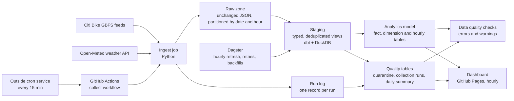
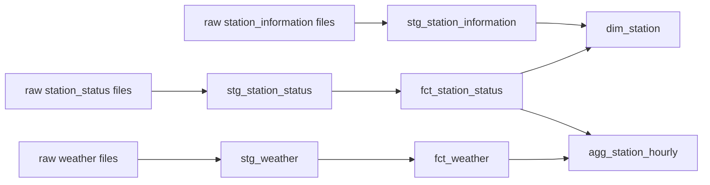

# Bike Share Data Pipeline

A data pipeline that collects live bike share station data and weather, stores it reliably, and turns it into tables ready for analysis.

Bike share systems publish how many bikes and docks every station has, refreshed about once a minute. Each refresh replaces the last, so the history is lost unless someone collects it. This pipeline collects it, alongside the weather at the time, and the goal is to answer questions such as which stations run empty, when, and how weather changes demand.

**Live dashboard: [dtox10011.github.io/bikeshare-data-pipeline](https://dtox10011.github.io/bikeshare-data-pipeline/)**, rebuilt from the collected data every hour.

**Status: in progress.** Milestones 1 to 5 and the dashboard are built and tested: raw ingestion, weather, scheduled collection, the SQL model, data quality checks, orchestration with Dagster, and a public dashboard. Docker packaging is next.

## Architecture



Solid lines are built. Dotted lines are planned.

## Milestones

| # | Stage | Status |
|---|-------|--------|
| 1 | Raw ingestion of station feeds, with tests and automated checks | Done |
| 2 | Weather ingestion, a run log, and a scheduled collection job | Done; GitHub's schedule runs far less often than asked (see [what the checks found](#what-the-checks-found)) |
| 3 | Staging views and an analytics model in SQL (dbt + DuckDB) | Done |
| 4 | Data quality checks, quarantine, and a daily quality summary | Done |
| 5 | Reliable 15-minute collection, and orchestration with Dagster (schedule, retries, backfills) | Done |
| 6 | A public dashboard, and Docker packaging | Dashboard done; Docker packaging next |

## What it collects

| Source | What it is | Refreshes | Collected |
|--------|-----------|-----------|-----------|
| `station_status` | Bikes and docks available at every station | About every minute | Every run |
| `station_information` | Station names, locations, and capacity | Rarely | Once per day |
| `weather` | Current temperature, rain, snow, wind, and cloud cover for one point in Manhattan | Every 15 minutes | Every run |

## Run it

Requires Python 3.10 or newer.

```bash
python -m pip install -r requirements.txt
python -m pytest                        # run the tests
python -m pipeline.ingest               # collect one snapshot of each source
python -m pipeline.ingest --every 900   # keep collecting every 15 minutes until stopped
python -m pipeline.transform            # build the warehouse tables and check the data's quality
dagster dev                             # open the orchestrator at http://localhost:3000
```

Each run writes files like this:

```
data/raw/station_status/dt=2026-10-03/hour=21/station_status_20261003T210405Z.json.gz
data/raw/weather/dt=2026-10-03/hour=21/weather_20261003T210000Z.json.gz
data/run_log/dt=2026-10-03/runs.jsonl
```

Run it again within the same minute and the station feed reports `skipped_duplicate`, because the source has not refreshed yet.

## Scheduled collection

A GitHub Actions workflow ([`collect.yml`](.github/workflows/collect.yml)) runs the ingest job and saves what it collects to a separate `data` branch of this repository. The code on `main` and the collected data never share history.

**What starts it.** GitHub's own scheduler was tried first and measured: asked to run every 15 minutes, it ran 10 times in about 40 hours, with gaps of two to seven hours (see [what the checks found](#what-the-checks-found)). So the workflow is started by an outside cron service instead, which calls GitHub's API every 15 minutes. GitHub's schedule stays on, once an hour, as a backup. Extra runs are harmless, because a snapshot that is already stored is skipped.

To set up the outside trigger (free, about ten minutes):

1. On GitHub, create a fine-grained personal access token with access to this repository only and one permission: **Actions: Read and write**. Note its expiry date.
2. On [cron-job.org](https://cron-job.org), create a job that runs every 15 minutes and sends:
   - `POST https://api.github.com/repos/DTOX10011/bikeshare-data-pipeline/actions/workflows/collect.yml/dispatches`
   - headers `Authorization: Bearer <token>`, `Accept: application/vnd.github+json`, `X-GitHub-Api-Version: 2022-11-28` and `Content-Type: application/json`
   - body `{"ref": "main"}`
3. A test run should return `204`, and a new run appears in the repository's Actions tab.

The token can only start this repository's workflows, so the worst a leaked token could do is run an extra collection. If it expires, the freshness check starts warning.

To get the collected data next to the code:

```bash
git fetch origin data
git worktree add ../bikeshare-data data   # the data appears in a sibling folder
```

If one source fails, the workflow still saves what the other sources returned, then marks the run as failed so the problem is visible in the Actions tab.

## The warehouse

`python -m pipeline.transform` runs the [dbt](https://www.getdbt.com/) project in [`transform/`](transform) against a local [DuckDB](https://duckdb.org/) file, `data/warehouse.duckdb`. It builds every table and then runs the data tests.

To build from the data the scheduled job has collected:

```bash
git fetch origin data
git worktree add ../bikeshare-data data
python -m pipeline.transform --raw-dir ../bikeshare-data/raw
```



| Table | One row per | What it holds |
|-------|-------------|---------------|
| `staging.stg_*` (views) | Station per snapshot, or weather reading | The raw files with every field typed and duplicates removed |
| `marts.fct_station_status` | Station per snapshot | Bikes, e-bikes and docks available, and whether the station was empty or full |
| `marts.fct_weather` | Weather reading (every 15 minutes) | Temperature, rain, snow, wind and cloud cover |
| `marts.dim_station` | Station | Latest name, location and capacity, and when the station was first and last seen |
| `marts.agg_station_hourly` | Station per hour | Average availability, share of the hour spent empty or full, local time, and that hour's weather |

Timestamps in the warehouse are UTC. `agg_station_hourly` also carries the hour in New York time, since demand follows the local clock.

An example question the model answers, which stations run empty most often:

```sql
select
    s.station_name,
    round(avg(h.share_of_snapshots_empty), 2) as share_of_time_empty
from marts.agg_station_hourly h
join marts.dim_station s using (station_id)
group by s.station_name
order by share_of_time_empty desc
limit 10;
```

## Data quality

`python -m pipeline.transform` runs every check after building the tables and lists any warnings at the end. Checks come in two strengths:

| Level | Meaning | Examples | What happens |
|-------|---------|----------|--------------|
| Error | The pipeline itself is wrong | A duplicate primary key, a fact row with no station, an unknown run status | The command fails |
| Warning | The data has a problem worth knowing about | A gap in collection, stations that stopped reporting, a value that could not be read | The tables are still built and the warning is listed |

The warnings, with the limits set in [`dbt_project.yml`](transform/dbt_project.yml):

| Check | Warns when |
|-------|-----------|
| `assert_station_status_is_fresh` | The newest snapshot is more than 60 minutes old |
| `assert_no_long_gaps_between_snapshots` | Two snapshots in the last 24 hours are more than 45 minutes apart |
| `assert_no_failed_collections` | A source failed in a collection run in the last 24 hours |
| `assert_no_recent_quarantined_rows` | Station rows were rejected in the last 24 hours |
| `assert_unreadable_values_are_rare` | More than 0.1% of the last 24 hours' rows had a value that could not be read |
| `assert_capacity_is_mostly_respected` | More than 1% of the last 24 hours' rows show more bikes plus docks than the station holds |
| `assert_open_stations_are_reporting` | More than 2% of open stations in the newest snapshot have not reported for 2 hours |
| `assert_ebikes_within_total_bikes` | A row reports more e-bikes than bikes |
| `non_negative` | A bike or dock count is below zero |

Three tables in the `quality` schema hold the detail behind the checks:

| Table | One row per | What it holds |
|-------|-------------|---------------|
| `quality.quarantine_station_status` | Rejected station row | Rows with no station id or no snapshot time, with the reason and the raw row |
| `quality.fct_collection_run` | Source per collection run | The run log as a table: status, duration, error, and minutes since the previous run |
| `quality.dq_daily_summary` | UTC day | Snapshots collected against the 96 a 15-minute schedule would give, the longest gap, failed runs, and rejected, unreadable and duplicate rows |

Every station row in `fct_station_status` also records how many of its values could not be read (`unreadable_value_count`) and how many duplicate copies of it were removed (`duplicates_removed`).

### What the checks found

Run against the data collected from 10 to 12 October 2026, the checks raised two warnings, both about collection rather than the data itself:

- **GitHub's schedule runs far less often than asked.** Instead of every 15 minutes, it ran 10 times in about 40 hours, with gaps of 148 to 433 minutes. Each day held 2 to 5% of the snapshots a 15-minute schedule would give. Every run succeeded, and each took under a second.
- **The data itself was clean.** No rows were rejected, no values were unreadable, and no counts were negative.

Things the checks deliberately do not warn about, because the real feed does them all the time:

- **Closed stations that never report.** 52 stations have no usable report time and about 10 more last reported over a day ago. Almost all are not installed, so the reporting check only looks at stations that say they are open. None of those were silent.
- **Small capacity overruns.** 24 of 25,190 rows reported more bikes plus docks than the station's capacity, by at most three. That is 0.1%, so the check only warns above 1%.
- **Stations with zero capacity.** 38 stations list a capacity of 0. The capacity check skips them.

## Orchestration

[Dagster](https://dagster.io/) runs everything after collection, from the definitions in [`orchestration/`](orchestration/definitions.py). It knows the whole pipeline as a graph of assets, from each raw source through every dbt model, and shows every dbt test as a check on the asset it tests.

```bash
set BIKESHARE_DATA_DIR=..\bikeshare-data      # Windows; on macOS or Linux use export
dagster dev                                    # then open http://localhost:3000
```

`BIKESHARE_DATA_DIR` is the folder holding `raw/` and `run_log/`: the worktree of the `data` branch from above, or `data` (the default) when collecting locally.

| What | Does | When |
|------|------|------|
| `collected_data` | Pulls the newest snapshots from the `data` branch (when the folder is a git checkout) | Every hour, with `refresh_warehouse` |
| `warehouse` | Runs the dbt project: staging, facts, dimensions, quality tables and every check | Every hour, with `refresh_warehouse` |
| `refresh_warehouse` job | Both of the above, in order | Every hour at ten past, on a schedule that is on from the start |
| `reload_days` job | The warehouse only, for a chosen range of days | When launched, with the dates set in its run config |

**Retries.** Pulling from GitHub is retried three times, waiting 30 seconds, then 90, then 210. The warehouse build is retried once after a minute, which covers the DuckDB file being briefly locked by another program.

**Backfills.** `reload_days` reloads exactly the chosen days from the raw files and leaves every other day alone. It replaces the full refresh that milestone 3 needed for a day older than the lookback window. The same works without Dagster:

```bash
python -m pipeline.transform --backfill 2026-10-01 2026-10-03
```

## Dashboard

The [dashboard](https://dtox10011.github.io/bikeshare-data-pipeline/) shows how many stations are empty right now, how the share of empty stations moved over the last three days next to the temperature, which stations were empty most often over the last week and where they are, and a data health panel with each day's completeness and the latest check results.

The [`dashboard`](.github/workflows/dashboard.yml) workflow rebuilds it once an hour, after the collection run that starts in the first quarter of each hour:

1. Check out the `data` branch and restore the previous build's warehouse from the Actions cache, so the build only loads the newest days. A change to the SQL models changes the cache key and forces a full rebuild.
2. Run `python -m pipeline.transform`, which builds every table and runs every check.
3. Run `python -m pipeline.dashboard`, which reads the warehouse and writes the site: one HTML page with the data embedded, plus the same data as `data.json`.
4. Publish the site to GitHub Pages.

To build it locally after `python -m pipeline.transform`:

```bash
python -m pipeline.dashboard    # writes site/index.html; open it in a browser
```

The page has no dependencies and loads nothing from other sites. Every chart has a table view, works with the keyboard, and follows the system's light or dark setting. Gaps in collection are drawn as shaded stretches, never as a line across missing time.

## The run log

Every run appends one line to `run_log/dt=YYYY-MM-DD/runs.jsonl`:

```json
{"run_id": "20261003T210500Z", "started_at": "2026-10-03T21:05:00+00:00", "finished_at": "2026-10-03T21:05:02+00:00",
 "sources": [{"source": "weather", "status": "written", "bytes": 512, "snapshot_time": "2026-10-03T21:00:00+00:00",
              "path": "weather/dt=2026-10-03/hour=21/weather_20261003T210000Z.json.gz", "error": null}]}
```

Each source ends a run with one of four statuses:

| Status | Meaning |
|--------|---------|
| `written` | A new snapshot was stored |
| `skipped_duplicate` | The source had not refreshed since the last run |
| `skipped_not_due` | A once-per-day source that was already collected today |
| `failed` | The download failed or the response was not valid; the error is recorded |

## Design decisions

**Raw data is stored exactly as received.** The ingest job does not parse, rename, or filter fields. If a later transformation has a bug, or a new question needs a field nobody used before, the original data is still there to reprocess.

**Loads are safe to rerun.** Files are named after the timestamp the source itself reports, not the time of the download. Fetching the same snapshot twice produces the same file name, so a retry or an overlapping schedule cannot create duplicates. Stored files are also byte-for-byte reproducible: the same payload always compresses to the same bytes.

**Writes are atomic.** Each file is written under a temporary name and renamed once complete, so a crash mid-write never leaves a half-written file that a later stage might read.

**Bad payloads are rejected before storage.** A response that is not valid JSON, or is missing the fields that identify it as the expected source (an error page, for example), is logged as a failure and not saved. The job exits with a non-zero code so a scheduler can alert on it.

**Temporary failures are retried.** Rate limits and server errors are retried with increasing waits before the run is marked as failed.

**One source failing does not stop the others.** Each source is collected independently, and the run log records the outcome of each one.

**Partitioned by date and hour, in UTC.** Later stages can process one hour or one day at a time, and backfilling a specific period means pointing at a specific folder. UTC avoids ambiguous hours when clocks change.

**Collection frequency matches how fast each source changes.** Station status is collected every run. Station reference data changes rarely and is the largest download, so it is collected once per UTC day; later runs that day skip the request entirely.

**Every run is recorded.** The run log is what makes gaps, failures, and late runs measurable rather than invisible.

**Staging reads the raw files directly, and bad values become nulls.** Each field is cast with `try_cast`, so one unreadable number costs one null in one row instead of a failed load. Fields the model does not use yet stay in the raw files.

**The fact tables load incrementally.** Each run reloads only the newest loaded day and the day before it, then replaces any rows it already had for those days (delete and insert on the primary key). Running it twice gives the same tables. The date filter is applied to the folder names, so an incremental run never opens older folders. On three days of full-size data (288 snapshots, about 725,000 rows), a full build including all 37 data tests takes about 12 seconds, and an incremental run about 10.

**Backfills reload chosen days.** A file that arrives for a day older than the lookback window is not picked up by an incremental run. A backfill names the days to reload, and the incremental models replace exactly those days. Because the raw zone is complete and never changes, `python -m pipeline.transform --full-refresh` can also rebuild every table from it.

**A scheduler is judged by what it delivers.** GitHub's schedule was kept until the run log showed it missing most of its slots. The fix changes only what starts the workflow; collection itself, and everything after it, stayed the same.

**The dashboard is a static page.** It is rebuilt from the warehouse and published as files, so there is no server to keep running and nothing to break between builds. Station names come from the feed, so the page inserts all text as text, never as HTML.

**Collection runs in the cloud, and the warehouse can be rebuilt anywhere.** Collecting must never stop, so it runs on GitHub. The warehouse can always catch up from the raw files, so it is built wherever it is needed: hourly by Dagster on the machine that queries it, and hourly in the dashboard workflow for the public page.

**Every fact row has a station to join to.** A station that reports status before its reference data arrives gets a placeholder row in `dim_station`, flagged `is_inferred`. A later run fills in its details.

**Bad rows are kept, not dropped.** A station row with no station id cannot be used, but it goes to a quarantine table with the reason instead of disappearing. A value that cannot be read becomes a null, and the row records that it happened. Problems are counted, so they can be checked.

**Warnings for the data, errors for the pipeline.** A missed collection or a silent station is a fact about the world: the tables should still be built, and the problem reported. A duplicate key means the code is wrong, so the run stops.

**Thresholds come from the real data.** Each limit was set after measuring what the feed normally does, so the checks stay quiet on ordinary behaviour and speak up when something changes.

**The checks can be run as of any time.** They measure "now" from a setting that defaults to the real time. The tests fix it, so they give the same result whenever they run.

**Empty and full only count while a station is in service.** A station that is switched off has no bikes to rent, but that is an outage, not a shortage, so it is not counted as empty.

## Known limitations

- **A station added mid-day has no details until the next day.** Its status rows are kept and it gets a placeholder row in `dim_station`, but its name, location and capacity stay empty until the next daily reference snapshot.
- **`dim_station` keeps only the latest details.** If a station is renamed or resized, earlier facts join to the new values. The daily reference snapshots are all in the raw zone, so a history-keeping (type 2) version can be built from them later.
- **The hourly table is rebuilt in full on every run.** Only the fact tables load incrementally. That is fast at this size and will need the same treatment as history grows.
- **The thresholds rest on a few days of data.** They should be revisited once weeks of history exist.
- **Quarantine reads recent raw files a second time.** Together with the new checks, that roughly doubled build time at this size.
- **The warehouse is a single local file.** DuckDB suits a project of this size and needs no server. The models are plain dbt SQL, so moving to a hosted warehouse means changing the connection profile and the file-reading step in staging.
- **One weather point stands in for the whole service area.** Conditions in the Bronx and in Jersey City are treated as the same as Manhattan's.
- **Weather is only collected going forward.** If a run is missed, that 15-minute reading is not recovered. A historical weather source could fill gaps, but it is not built.
- **Dagster runs only while its machine is on.** Collection does not depend on it, and the hourly refresh catches up from the raw files when Dagster starts again.
- **The outside trigger depends on a token that expires.** It has to be renewed on GitHub and updated on cron-job.org. The freshness check warns when collection stops.
- **Storing data on a git branch does not scale.** It costs nothing and needs no accounts, which suits a project of this size, but the branch grows with every run. Object storage such as S3 is the right home for a raw zone, and moving to it only changes the workflow's save step.

## Data sources

- Station data comes from Citi Bike's public [GBFS](https://gbfs.org/) feeds.
- Weather data comes from [Open-Meteo](https://open-meteo.com/).
