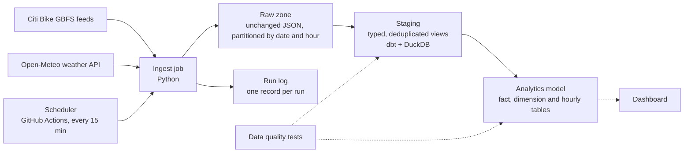
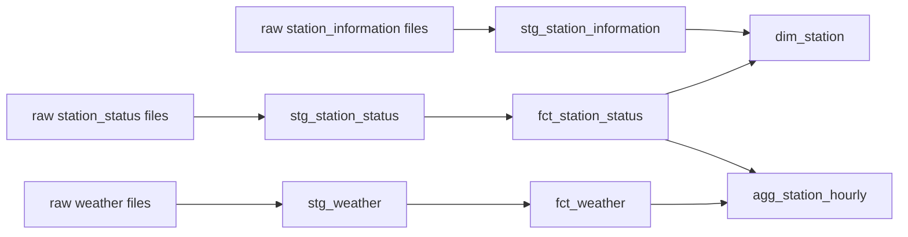

# Bike Share Data Pipeline

A data pipeline that collects live bike share station data and weather, stores it reliably, and turns it into tables ready for analysis.

Bike share systems publish how many bikes and docks every station has, refreshed about once a minute. Each refresh replaces the last, so the history is lost unless someone collects it. This pipeline collects it, alongside the weather at the time, and the goal is to answer questions such as which stations run empty, when, and how weather changes demand.

**Status: in progress.** Milestones 1 to 3 are built and tested: raw ingestion, weather, scheduled collection, and the SQL model. The later stages are planned, and this README is updated as each one lands.

## Architecture



Solid lines are built. Dotted lines are planned.

## Milestones

| # | Stage | Status |
|---|-------|--------|
| 1 | Raw ingestion of station feeds, with tests and automated checks | Done |
| 2 | Weather ingestion, a run log, and a scheduled collection job | Done; verified by a manual run, first automatic run not yet observed |
| 3 | Staging views and an analytics model in SQL (dbt + DuckDB) | Done |
| 4 | Data quality tests on every stage | Planned |
| 5 | Orchestration with retries and backfills | Planned |
| 6 | Docker packaging and a dashboard | Planned |

## What it collects

| Source | What it is | Refreshes | Collected |
|--------|-----------|-----------|-----------|
| `station_status` | Bikes and docks available at every station | About every minute | Every run |
| `station_information` | Station names, locations, and capacity | Rarely | Once per day |
| `weather` | Current temperature, rain, snow, wind, and cloud cover for one point in Manhattan | Every 15 minutes | Every run |

## Run it

Requires Python 3.10 or newer.

```bash
python -m pip install -r requirements.txt
python -m pytest                        # run the tests
python -m pipeline.ingest               # collect one snapshot of each source
python -m pipeline.ingest --every 900   # keep collecting every 15 minutes until stopped
python -m pipeline.transform            # build the warehouse tables from what was collected
```

Each run writes files like this:

```
data/raw/station_status/dt=2026-10-03/hour=21/station_status_20261003T210405Z.json.gz
data/raw/weather/dt=2026-10-03/hour=21/weather_20261003T210000Z.json.gz
data/run_log/dt=2026-10-03/runs.jsonl
```

Run it again within the same minute and the station feed reports `skipped_duplicate`, because the source has not refreshed yet.

## Scheduled collection

A GitHub Actions workflow ([`collect.yml`](.github/workflows/collect.yml)) runs the ingest job every 15 minutes and saves what it collects to a separate `data` branch of this repository. The code on `main` and the collected data never share history.

To get the collected data next to the code:

```bash
git fetch origin data
git worktree add ../bikeshare-data data   # the data appears in a sibling folder
```

If one source fails, the workflow still saves what the other sources returned, then marks the run as failed so the problem is visible in the Actions tab.

GitHub does not guarantee scheduled workflows start on time, so gaps between snapshots vary. The run log records when each run happened, which lets later stages measure those gaps instead of assuming a fixed interval.

## The warehouse

`python -m pipeline.transform` runs the [dbt](https://www.getdbt.com/) project in [`transform/`](transform) against a local [DuckDB](https://duckdb.org/) file, `data/warehouse.duckdb`. It builds every table and then runs the data tests.

To build from the data the scheduled job has collected:

```bash
git fetch origin data
git worktree add ../bikeshare-data data
python -m pipeline.transform --raw-dir ../bikeshare-data/raw
```



| Table | One row per | What it holds |
|-------|-------------|---------------|
| `staging.stg_*` (views) | Station per snapshot, or weather reading | The raw files with every field typed and duplicates removed |
| `marts.fct_station_status` | Station per snapshot | Bikes, e-bikes and docks available, and whether the station was empty or full |
| `marts.fct_weather` | Weather reading (every 15 minutes) | Temperature, rain, snow, wind and cloud cover |
| `marts.dim_station` | Station | Latest name, location and capacity, and when the station was first and last seen |
| `marts.agg_station_hourly` | Station per hour | Average availability, share of the hour spent empty or full, local time, and that hour's weather |

Timestamps in the warehouse are UTC. `agg_station_hourly` also carries the hour in New York time, since demand follows the local clock.

An example question the model answers, which stations run empty most often:

```sql
select
    s.station_name,
    round(avg(h.share_of_snapshots_empty), 2) as share_of_time_empty
from marts.agg_station_hourly h
join marts.dim_station s using (station_id)
group by s.station_name
order by share_of_time_empty desc
limit 10;
```

## The run log

Every run appends one line to `run_log/dt=YYYY-MM-DD/runs.jsonl`:

```json
{"run_id": "20261003T210500Z", "started_at": "2026-10-03T21:05:00+00:00", "finished_at": "2026-10-03T21:05:02+00:00",
 "sources": [{"source": "weather", "status": "written", "bytes": 512, "snapshot_time": "2026-10-03T21:00:00+00:00",
              "path": "weather/dt=2026-10-03/hour=21/weather_20261003T210000Z.json.gz", "error": null}]}
```

Each source ends a run with one of four statuses:

| Status | Meaning |
|--------|---------|
| `written` | A new snapshot was stored |
| `skipped_duplicate` | The source had not refreshed since the last run |
| `skipped_not_due` | A once-per-day source that was already collected today |
| `failed` | The download failed or the response was not valid; the error is recorded |

## Design decisions

**Raw data is stored exactly as received.** The ingest job does not parse, rename, or filter fields. If a later transformation has a bug, or a new question needs a field nobody used before, the original data is still there to reprocess.

**Loads are safe to rerun.** Files are named after the timestamp the source itself reports, not the time of the download. Fetching the same snapshot twice produces the same file name, so a retry or an overlapping schedule cannot create duplicates. Stored files are also byte-for-byte reproducible: the same payload always compresses to the same bytes.

**Writes are atomic.** Each file is written under a temporary name and renamed once complete, so a crash mid-write never leaves a half-written file that a later stage might read.

**Bad payloads are rejected before storage.** A response that is not valid JSON, or is missing the fields that identify it as the expected source (an error page, for example), is logged as a failure and not saved. The job exits with a non-zero code so a scheduler can alert on it.

**Temporary failures are retried.** Rate limits and server errors are retried with increasing waits before the run is marked as failed.

**One source failing does not stop the others.** Each source is collected independently, and the run log records the outcome of each one.

**Partitioned by date and hour, in UTC.** Later stages can process one hour or one day at a time, and backfilling a specific period means pointing at a specific folder. UTC avoids ambiguous hours when clocks change.

**Collection frequency matches how fast each source changes.** Station status is collected every run. Station reference data changes rarely and is the largest download, so it is collected once per UTC day; later runs that day skip the request entirely.

**Every run is recorded.** The run log is what makes gaps, failures, and late runs measurable rather than invisible.

**Staging reads the raw files directly, and bad values become nulls.** Each field is cast with `try_cast`, so one unreadable number costs one null in one row instead of a failed load. Fields the model does not use yet stay in the raw files.

**The fact tables load incrementally.** Each run reloads only the newest loaded day and the day before it, then replaces any rows it already had for those days (delete and insert on the primary key). Running it twice gives the same tables. The date filter is applied to the folder names, so an incremental run never opens older folders. On three days of full-size data (288 snapshots, about 725,000 rows) a full build takes about six seconds.

**Backfills use a full refresh.** A file that arrives for a day older than the lookback window is not picked up by an incremental run. Because the raw zone is complete and never changes, `python -m pipeline.transform --full-refresh` rebuilds every table from it.

**Every fact row has a station to join to.** A station that reports status before its reference data arrives gets a placeholder row in `dim_station`, flagged `is_inferred`. A later run fills in its details.

**Empty and full only count while a station is in service.** A station that is switched off has no bikes to rent, but that is an outage, not a shortage, so it is not counted as empty.

## Known limitations

- **A station added mid-day has no details until the next day.** Its status rows are kept and it gets a placeholder row in `dim_station`, but its name, location and capacity stay empty until the next daily reference snapshot.
- **`dim_station` keeps only the latest details.** If a station is renamed or resized, earlier facts join to the new values. The daily reference snapshots are all in the raw zone, so a history-keeping (type 2) version can be built from them later.
- **The hourly table is rebuilt in full on every run.** Only the fact tables load incrementally. That is fast at this size and will need the same treatment as history grows.
- **The warehouse is a single local file.** DuckDB suits a project of this size and needs no server. The models are plain dbt SQL, so moving to a hosted warehouse means changing the connection profile and the file-reading step in staging.
- **One weather point stands in for the whole service area.** Conditions in the Bronx and in Jersey City are treated as the same as Manhattan's.
- **Weather is only collected going forward.** If a run is missed, that 15-minute reading is not recovered. Backfilling from a historical weather source is planned with the orchestration stage.
- **Storing data on a git branch does not scale.** It costs nothing and needs no accounts, which suits a project of this size, but the branch grows with every run. Object storage such as S3 is the right home for a raw zone, and moving to it only changes the workflow's save step.

## Data sources

- Station data comes from Citi Bike's public [GBFS](https://gbfs.org/) feeds.
- Weather data comes from [Open-Meteo](https://open-meteo.com/).
