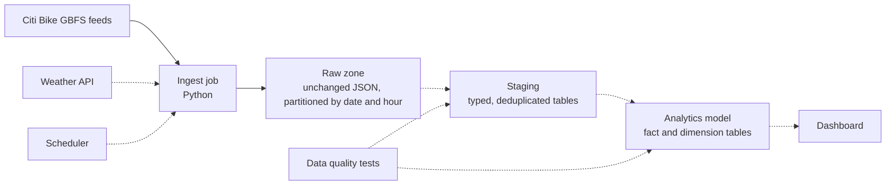

# Bike Share Data Pipeline

A data pipeline that collects live bike share station data, stores it reliably, and turns it into tables ready for analysis.

Bike share systems publish how many bikes and docks every station has, refreshed about once a minute. Each refresh replaces the last, so the history is lost unless someone collects it. This pipeline collects it, and the goal is to answer questions such as which stations run empty, when, and how weather changes demand.

**Status: in progress.** Milestone 1 (raw ingestion) is built and tested. The later stages are planned, and this README is updated as each one lands.

## Architecture



Solid lines are built. Dotted lines are planned.

## Milestones

| # | Stage | Status |
|---|-------|--------|
| 1 | Raw ingestion of station feeds, with tests and automated checks | Done |
| 2 | Weather ingestion and a scheduled collection job | Planned |
| 3 | Staging tables and an analytics model in SQL | Planned |
| 4 | Data quality tests on every stage | Planned |
| 5 | Orchestration with retries and backfills | Planned |
| 6 | Docker packaging and a dashboard | Planned |

## Run it

Requires Python 3.10 or newer.

```bash
python -m pip install -r requirements.txt
python -m pytest            # run the tests
python -m pipeline.ingest   # collect one snapshot of each feed
```

Each run writes files like this:

```
data/raw/station_status/dt=2026-10-03/hour=21/station_status_20261003T210405Z.json.gz
```

Run it again within the same minute and it reports `skipped_duplicate`, because the feed has not refreshed yet.

## Design decisions

**Raw data is stored exactly as received.** The ingest job does not parse, rename, or filter fields. If a later transformation has a bug, or a new question needs a field nobody used before, the original data is still there to reprocess.

**Loads are safe to rerun.** Files are named after the timestamp the feed itself reports, not the time of the download. Fetching the same snapshot twice produces the same file name, so a retry or an overlapping schedule cannot create duplicates.

**Writes are atomic.** Each file is written under a temporary name and renamed once complete, so a crash mid-write never leaves a half-written file that a later stage might read.

**Bad payloads are rejected before storage.** A response that is not valid JSON, or has no station list or timestamp (an error page, for example), is logged as a failure and not saved. The job exits with a non-zero code so a scheduler can alert on it.

**Temporary failures are retried.** Rate limits and server errors are retried with increasing waits before the run is marked as failed.

**Partitioned by date and hour, in UTC.** Later stages can process one hour or one day at a time, and backfilling a specific period means pointing at a specific folder. UTC avoids ambiguous hours when clocks change.

## Data source

Station data comes from Citi Bike's public [GBFS](https://gbfs.org/) feeds.
